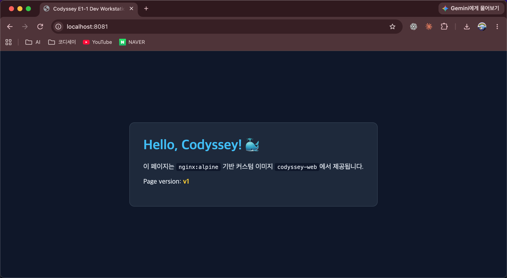

# Codyssey E1-1 · 개발 워크스테이션 구축

> 터미널 · Docker · Git/GitHub 를 직접 세팅하고, **실행 결과(로그 · 접속 · 데이터 유지)** 로 동작을 검증한 기록입니다.
> 이 README 에는 **목적 · 주요 수행 내용 · 핵심 결과** 만 담았습니다. 명령별 실행 로그와 검증 과정은 각 항목의 링크에서 볼 수 있습니다.

## 목차

1. [프로젝트 개요](#1-프로젝트-개요)
2. [실행 환경](#2-실행-환경)
3. [수행 체크리스트 및 결과 요약](#3-수행-체크리스트-및-결과-요약)
4. [빠른 재현 방법](#4-빠른-재현-방법)
5. [트러블슈팅 요약](#5-트러블슈팅-요약)
6. [보안 및 개인정보 처리](#6-보안-및-개인정보-처리)
7. [저장소 구조 및 상세 문서](#7-저장소-구조-및-상세-문서)

---

## 1. 프로젝트 개요

**목표** — 개발에 필요한 기본 도구(터미널, Docker, Git)를 직접 설치·설정하고, "된다"는 것을 **실행 결과로 증명**하는 것.

| 영역 | 한 일 |
|---|---|
| 터미널 · 권한 | 파일/디렉토리 생성·복사·이동·삭제, 절대/상대 경로 비교, `chmod` 전/후 동작 비교 |
| Docker 기초 | Docker Desktop 설치·점검, `hello-world` / `ubuntu` 실행, `run -it` · `exec` · `attach` 비교 |
| 커스텀 이미지 · 네트워크 | `nginx:alpine` 기반 이미지 제작, 같은 이미지를 8080/8081 두 포트로 실행 |
| 데이터 | 바인드 마운트(호스트 수정 즉시 반영), 볼륨(컨테이너 삭제 후에도 유지, 백업/복원) |
| Git / GitHub | 사용자 정보 · 기본 브랜치 설정, VSCode 연동, SSH 키로 push |
| 보너스 | Compose 단일/멀티 컨테이너, 서비스 이름으로 통신, 환경 변수로 포트·모드 변경 |

**핵심 메시지** — 이미지는 "실행 환경의 설계도", 컨테이너는 "그 설계도로 만든 격리된 실행 인스턴스" 입니다.
포트 매핑으로 바깥과 연결하고, 마운트/볼륨으로 데이터를 컨테이너 수명과 분리하면 **같은 서비스를 몇 번 실행해도 같은 결과가 재현** 됩니다.

---

## 2. 실행 환경

| 항목 | 값 |
|---|---|
| OS | macOS 12.7.6 Monterey, Intel x86_64 |
| Shell / Terminal | zsh / VSCode 통합 터미널 |
| Docker | Docker Desktop **4.41.2** · Engine **28.1.1** · Compose **v2.35.1** |
| Git | **2.37.1** |

<details>
<summary>버전 확인 명령 및 출력</summary>

```bash
$ sw_vers
ProductName:	macOS
ProductVersion:	12.7.6
BuildVersion:	21H1320

$ echo $SHELL
/bin/zsh

$ docker --version
Docker version 28.1.1, build 4eba377

$ git --version
git version 2.37.1 (Apple Git-137.1)
```

</details>

> ⚠️ 과제 안내의 OrbStack 은 **macOS 14 이상** 에서만 실행되어, macOS 12 를 지원하는 마지막 버전인 **Docker Desktop 4.41.2** 를 사용했습니다. `docker` 명령은 동일합니다. → [트러블슈팅 #1](docs/TROUBLESHOOTING.md#ts1)

---

## 3. 수행 체크리스트 및 결과 요약

터미널 · 권한 · Docker · Dockerfile · 포트 · 마운트 · 볼륨 · Git · GitHub 전 항목을 완료했습니다.
**상세** 링크에 실행 명령과 출력(코드블록), 전/후 비교가 있고, **로그** 는 터미널 원본입니다.

### 기본 과제

| # | 항목 | 완료 | 핵심 결과 | 상세 · 로그 |
|---|---|:---:|---|---|
| 1 | 터미널 기본 조작 | ✅ | `pwd`, `ls -la`(숨김 파일 확인), `mkdir -p`, `cp -r`, `mv`, `rm -r`, `cat`, `touch` 수행. 같은 파일을 절대/상대 경로로 각각 열어 동일 결과 확인 | [6.1](docs/VERIFICATION.md#61-터미널-기본-조작) · [log](docs/logs/03-terminal.log) |
| 2 | 권한 실습 | ✅ | 파일 2개 · 디렉토리 1개의 권한을 바꿔 가며 확인. `644` 스크립트는 실행 거부 → `755` 에서 실행 성공, 디렉토리는 `x` 가 없으면 이름을 알아도 접근 불가 | [6.2](docs/VERIFICATION.md#62-권한-실습) · [log](docs/logs/04-permission.log) |
| 3 | Docker 설치 · 점검 | ✅ | `docker version` 에 Client/Server 모두 출력 → 데몬 정상 동작. 데몬이 없을 때의 에러 출력도 비교 | [6.3](docs/VERIFICATION.md#63-docker-설치-및-점검) · [log](docs/logs/05-docker-check.log) |
| 4 | Docker 기본 운영 | ✅ | `pull` / `images` / `ps -a` / `start` · `stop` / `logs` / `stats` 수행. 정리는 컨테이너 → 이미지 순서 (반대면 conflict) | [6.4](docs/VERIFICATION.md#64-docker-기본-운영-명령) · [log](docs/logs/09-ops.log) |
| 5 | hello-world · ubuntu | ✅ | hello-world 성공, ubuntu 안에서 명령 실행. `exec` 는 나와도 컨테이너 유지, `attach` 는 `exit` 시 컨테이너 종료 | [6.5](docs/VERIFICATION.md#65-컨테이너-실행-실습-hello-world--ubuntu) · [log](docs/logs/07-ubuntu.log) |
| 6 | 커스텀 이미지 | ✅ | `nginx:alpine` 위에 내 페이지 · `/health` · 응답 헤더 · HEALTHCHECK 추가 → `codyssey-web:1.0`, `docker ps` 에 `(healthy)` | [6.6](docs/VERIFICATION.md#66-dockerfile-기반-커스텀-이미지) · [Dockerfile](app/Dockerfile) · [log](docs/logs/08-build-run.log) |
| 7 | 포트 매핑 | ✅ | 같은 이미지를 `8080`, `8081` 로 동시 실행 → 둘 다 `200 OK`, 응답 헤더로 서로 다른 컨테이너임을 확인, 브라우저 접속 | [6.7](docs/VERIFICATION.md#67-포트-매핑-및-접속-증거) · [log](docs/logs/08-build-run.log) |
| 8 | 바인드 마운트 | ✅ | 호스트에서 파일을 v1 → v2 로 고치자 **재시작 없이** 응답이 v2 로 바뀜. `:ro` 라 컨테이너 안에서 쓰기는 거부 | [6.8](docs/VERIFICATION.md#68-바인드-마운트-호스트-변경-즉시-반영) · [log](docs/logs/10-mount-volume.log) |
| 9 | 볼륨 영속성 | ✅ | 컨테이너 삭제 후 새 컨테이너에서 **이전 데이터 그대로**. 볼륨 없이 쓴 파일은 삭제됨(대조 실험). `tar` 백업 → 복원 후 해시 일치 | [6.9](docs/VERIFICATION.md#69-docker-볼륨-영속성) · [log](docs/logs/10-mount-volume.log) · [backup log](docs/logs/16-volume-backup.log) |
| 10 | Git · VSCode 연동 | ✅ | `user.name` / `user.email` / `init.defaultBranch=main` 설정, VSCode 에 GitHub 로그인 및 저장소 연동 | [6.10](docs/VERIFICATION.md#610-git-설정-및-githubvscode-연동) · [log](docs/logs/02-git.log) |
| 11 | 포트 충돌 진단 | ✅ | `lsof` · `netstat` 로 점유 프로세스 확인 → 대체 포트 또는 점유 컨테이너 정리 / `kill` 로 해제 | [6.11](docs/VERIFICATION.md#611-포트-충돌-진단-및-해결) · [log](docs/logs/15-port-conflict.log) |

<p align="center">
  
  
</p>

### 보너스 과제

| # | 항목 | 완료 | 핵심 결과 | 상세 · 로그 |
|---|---|:---:|---|---|
| B1 | Compose 기초 | ✅ | 긴 `docker run` 명령을 `docker-compose.yml` 로 옮겨 `docker compose up -d` 한 줄로 실행 | [7.1](docs/BONUS.md#71-compose-기초-단일-서비스) · [log](docs/logs/11-compose-single.log) |
| B2 | 멀티 컨테이너 통신 | ✅ | web(nginx) + api(Python). `http://api:5000` 처럼 **서비스 이름**으로 양방향 통신 성공. api 는 외부 미공개 | [7.2](docs/BONUS.md#72-compose-멀티-컨테이너--서비스-간-통신) · [log](docs/logs/12-compose-multi.log) |
| B3 | Compose 운영 | ✅ | `up` → `ps` → `logs` → `down` → `ps -a` 로 정리까지 확인 | [7.3](docs/BONUS.md#73-compose-운영-루틴) |
| B4 | 환경 변수 | ✅ | 코드 수정 없이 `WEB_PORT=8091 API_PORT=7000 APP_MODE=prod` 로 포트 · 모드 변경 | [7.4](docs/BONUS.md#74-환경-변수로-포트모드-변경) · [log](docs/logs/13-compose-env.log) |
| B5 | SSH 키 | ✅ | `ssh -T git@github.com` 인증 성공, SSH 주소로 push | [7.5](docs/BONUS.md#75-github-ssh-키) · [log](docs/logs/14-github-ssh.log) |

### 검증 방법

어떤 명령으로 무엇을 확인했는지와 결과 위치입니다.

| 검증 대상 | 사용한 명령 | 기대 결과 (확인 포인트) | 증거 |
|---|---|---|---|
| 숨김 파일 | `ls -la` | `.hidden_config` 표시 | [6.1](docs/VERIFICATION.md#61-터미널-기본-조작) |
| 권한 변경 | `chmod` + `stat -f "%Sp %Lp"` | 전/후 권한 값 변화 + 실행/쓰기 성공·실패 | [6.2](docs/VERIFICATION.md#62-권한-실습) |
| 데몬 동작 | `docker info` | Server Version 등 출력 | [6.3](docs/VERIFICATION.md#63-docker-설치-및-점검) |
| 이미지 빌드 | `docker build`, `docker images`, `image inspect` | 태그 생성, LABEL/ENV/HEALTHCHECK 반영 | [6.6](docs/VERIFICATION.md#66-dockerfile-기반-커스텀-이미지) |
| 컨테이너 상태 | `docker ps` | `Up (healthy)` | [6.4](docs/VERIFICATION.md#64-docker-기본-운영-명령) |
| 포트 매핑 | `docker port`, `curl -i`, 브라우저 | 200 OK, 포트별 다른 `X-Served-By` | [6.7](docs/VERIFICATION.md#67-포트-매핑-및-접속-증거) |
| 바인드 마운트 | `sed` 수정 후 `curl` | v1 → v2 즉시 반영, `:ro` 쓰기 거부 | [6.8](docs/VERIFICATION.md#68-바인드-마운트-호스트-변경-즉시-반영) |
| 볼륨 영속성 | `rm -f` 후 새 컨테이너에서 `cat` | 이전 컨테이너가 쓴 내용 유지 | [6.9](docs/VERIFICATION.md#69-docker-볼륨-영속성) |
| 볼륨 백업/복원 | `tar czf` 백업 → 새 볼륨에 `tar xzf` → `sha256sum` 비교 | 원본 = 복원본 | [6.9](docs/VERIFICATION.md#69-docker-볼륨-영속성) |
| 포트 충돌 | `lsof -iTCP:<포트> -sTCP:LISTEN`, `netstat -anv`, `docker ps --filter publish=` | 점유 PID/컨테이너 식별 → `kill`/`rm -f` 후 비어 있음 | [6.11](docs/VERIFICATION.md#611-포트-충돌-진단-및-해결) |
| 데몬 연결 실패 | `DOCKER_HOST=<없는 소켓> docker info` | `Cannot connect ...`, exit 1 | [6.3](docs/VERIFICATION.md#63-docker-설치-및-점검) |
| 정리 | `docker rm`, `rmi`, `image prune`, `system df` | 컨테이너 → 이미지 순서, 사용량 감소 | [6.4](docs/VERIFICATION.md#64-docker-기본-운영-명령) |
| Git 설정 | `git config --list --show-origin` | user.name/email, defaultbranch=main | [6.10](docs/VERIFICATION.md#610-git-설정-및-githubvscode-연동) |
| 서비스 간 통신 | `compose exec web wget http://api:5000` | api JSON 응답 | [7.2](docs/BONUS.md#72-compose-멀티-컨테이너--서비스-간-통신) |
| 환경 변수 | `VAR=... docker compose up` + `printenv` | port 7000, mode prod | [7.4](docs/BONUS.md#74-환경-변수로-포트모드-변경) |
| SSH 인증 | `ssh -T git@github.com`, `git push` | `Hi ll-0l!`, push 성공 | [7.5](docs/BONUS.md#75-github-ssh-키) |

---

## 4. 빠른 재현 방법

> 사전 조건: Docker 엔진이 실행 중이어야 합니다 (`docker info` 가 에러 없이 출력되면 OK).

```bash
git clone https://github.com/ll-0l/codyssey-e1-1-dev-workstation.git
cd codyssey-e1-1-dev-workstation

# 0) 사용할 호스트 포트가 비어 있는지 확인 (출력이 없으면 비어 있음)
for p in 8080 8081 8082 8085 8090; do lsof -nP -iTCP:$p -sTCP:LISTEN; done

# 1) 커스텀 이미지 빌드 → 두 포트로 실행
docker build -t codyssey-web:1.0 ./app
docker run -d -p 8080:80 --name web-8080 codyssey-web:1.0
docker run -d -p 8081:80 --name web-8081 codyssey-web:1.0
curl http://localhost:8080/health      # ok

# 2) 바인드 마운트
docker run -d -p 8082:80 --name web-bind -v "$(pwd)/mount-demo":/usr/share/nginx/html:ro codyssey-web:1.0

# 3) 볼륨 영속성
docker volume create codyssey-data
docker run -d --name vol-test -v codyssey-data:/data ubuntu:22.04 sleep infinity
docker exec vol-test bash -lc 'echo hi > /data/hello.txt'
docker rm -f vol-test
docker run --rm -v codyssey-data:/data ubuntu:22.04 cat /data/hello.txt   # hi

# 4) (보너스) Compose
cd compose && docker compose up -d --build && curl http://localhost:8090/api/info

# 정리
docker compose down; cd ..
docker rm -f web-8080 web-8081 web-bind
docker volume rm codyssey-data
```

- 포트가 이미 사용 중이면 `-p <다른포트>:80` 또는 `compose/.env` 의 `WEB_PORT` 를 바꿉니다. 진단 절차: [6.11](docs/VERIFICATION.md#611-포트-충돌-진단-및-해결)
- 빌드 결과가 이상하면 캐시 무시 재빌드: `docker build --no-cache --pull -t codyssey-web:1.0 ./app`
- Windows 에서는 `$(pwd)` 대신 PowerShell `${PWD}`, CMD `%cd%` 를 사용합니다. ([OS별 경로 차이](docs/CONCEPTS.md#os별-경로-차이))

---

## 5. 트러블슈팅 요약

| # | 문제 | 원인 가설 | 확인 | 해결 / 대안 |
|---|---|---|---|---|
| [1](docs/TROUBLESHOOTING.md#ts1) | OrbStack 이 설치되지 않음 | 최소 지원 macOS 가 12 보다 높다 | 앱의 `Info.plist` → `LSMinimumSystemVersion = 14.0` | Docker Desktop 4.41.2 로 대체, 자동 업데이트 끔 |
| [2](docs/TROUBLESHOOTING.md#ts2) | `docker exec` 에서 컨테이너가 아닌 Mac 의 hostname 출력 | 큰따옴표 안 `$(hostname)` 을 호스트 셸이 먼저 치환 | 출력값이 Mac 이름과 동일 | 작은따옴표 + `sh -c '...'` 로 컨테이너 안에서 해석 |
| [3](docs/TROUBLESHOOTING.md#3-docker-stop-이-10초나-걸리고-exit-code-137-로-종료됨) | `docker stop` 이 10초 걸리고 Exit 137 | PID 1 인 bash 가 SIGTERM 무시 → 10초 후 SIGKILL | `docker ps -a` 에 `Exited (137)` (137 = 128 + 9) | 테스트는 `stop -t 1`, 서비스는 `--init` 또는 신호 처리 프로세스 |
| [4](docs/TROUBLESHOOTING.md#ts4) | `port is already allocated` | 호스트 포트를 다른 프로세스가 이미 사용 중 | `lsof` · `netstat` 로 PID, `docker ps --filter publish=` 로 컨테이너 확인 | 대체 포트 또는 기존 컨테이너 정리 |

→ 명령과 출력이 포함된 상세 과정: [docs/TROUBLESHOOTING.md](docs/TROUBLESHOOTING.md)

---

## 6. 보안 및 개인정보 처리

- **커밋 이메일**: 공개 저장소이므로 저장소 단위로 GitHub noreply 이메일 사용, 문서 내 개인 이메일은 `<masked>`
- **토큰 · SSH**: 토큰 값과 SSH 키 지문은 문서에 남기지 않음, 개인키 내용은 다루지 않음 (공개키 `.pub` 경로만 표시)
- **`.env`**: 포트/모드 같은 실행 설정만 포함, 비밀번호 · API 키 없음
- **스크린샷**: 계정 아이디 외 이메일 · 토큰 · 인증 코드가 보이지 않는지 확인 후 첨부
- **커밋 전 점검**: `grep -rniE "ghp_|gho_|password|PRIVATE KEY" .`
- **노출 시 대응**: 민감정보가 커밋되면 파일 삭제만으로는 히스토리에 남으므로 `git filter-repo` 등으로 히스토리에서 제거하고, 해당 토큰/키는 즉시 폐기 후 재발급

---

## 7. 저장소 구조 및 상세 문서

```text
codyssey-e1-1-dev-workstation/
├── README.md                 # 요약 문서 (이 파일)
├── app/                      # [필수] 커스텀 이미지 빌드 컨텍스트 (Dockerfile, nginx 설정, 페이지)
├── mount-demo/               # [필수] 바인드 마운트 실습용 (이미지와 분리해 "호스트만 바꿔도 반영" 증명)
├── practice/                 # [필수] 터미널 · 권한 실습 결과물
├── compose/                  # [보너스] 단일/멀티 컨테이너, .env, Python API
└── docs/                     # 상세 문서 · 원본 로그 · 스크린샷
```

| 문서 | 내용 |
|---|---|
| [docs/VERIFICATION.md](docs/VERIFICATION.md) | 기본 과제 수행 로그 및 검증 (6.1 ~ 6.11), 검증 방법 요약표, 증거 파일 목록 |
| [docs/BONUS.md](docs/BONUS.md) | 보너스 과제 상세 (Compose, 환경 변수, SSH 키) |
| [docs/TROUBLESHOOTING.md](docs/TROUBLESHOOTING.md) | 트러블슈팅 4건 상세 |
| [docs/CONCEPTS.md](docs/CONCEPTS.md) | 개념 정리 (경로, 권한, 이미지/컨테이너, 포트 매핑, 볼륨, Git/GitHub) |
| [docs/logs/](docs/logs/) | 단계별 터미널 원본 로그 (`$ 명령` + 출력) |
| [docs/PEER_REVIEW.md](docs/PEER_REVIEW.md) · [PEER_REVIEW_EASY.md](docs/PEER_REVIEW_EASY.md) | 동료평가 대비 항목별 답변 / 쉬운 말 버전 |
