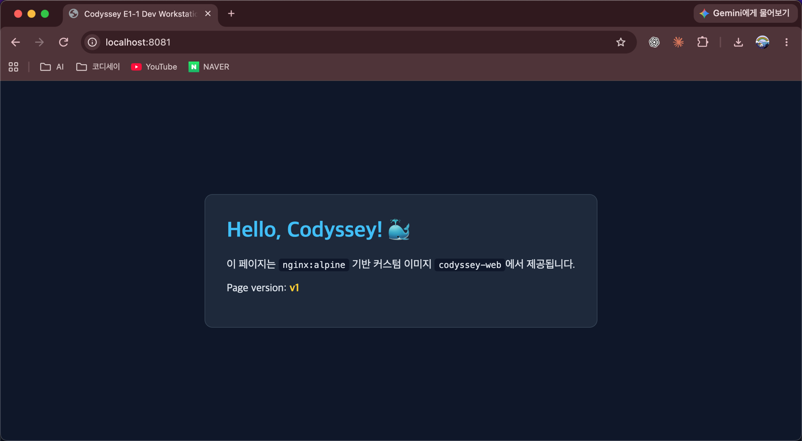
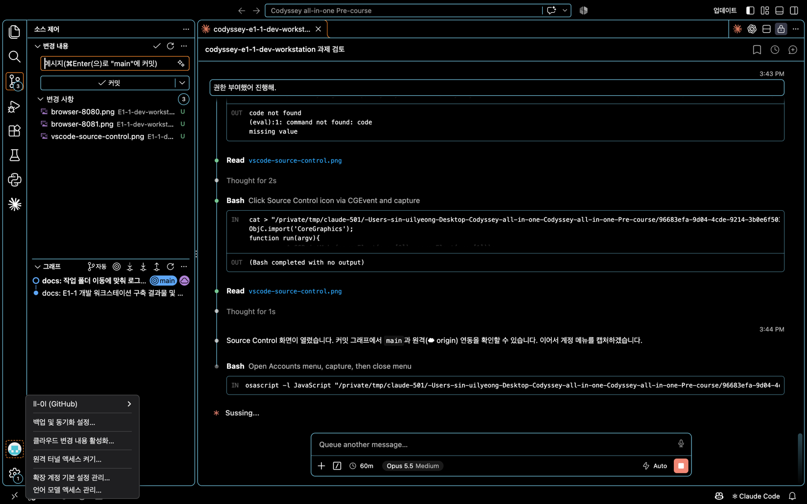
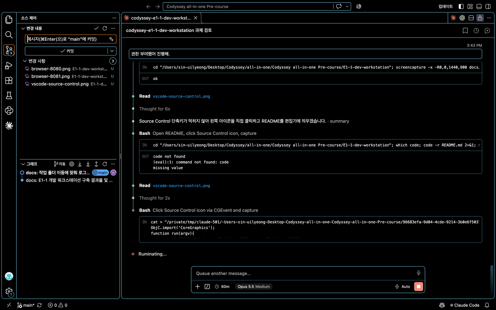

# 수행 로그 및 검증 (기본 과제)

> ← [README 로 돌아가기](../README.md)
>
> README 의 [수행 결과 요약](../README.md#3-수행-체크리스트-및-결과-요약) 에서 한 줄로 정리한 항목들의 **실행 명령 · 출력 · 전/후 비교** 상세입니다.
> 터미널 원본 로그 전체는 [`logs/`](logs) 에 있습니다.

## 목차

- [검증 방법 요약표](#검증-방법-요약표)
- [6.1 터미널 기본 조작](#61-터미널-기본-조작)
- [6.2 권한 실습](#62-권한-실습)
- [6.3 Docker 설치 및 점검](#63-docker-설치-및-점검)
- [6.4 Docker 기본 운영 명령](#64-docker-기본-운영-명령)
- [6.5 컨테이너 실행 실습 (hello-world / ubuntu)](#65-컨테이너-실행-실습-hello-world--ubuntu)
- [6.6 Dockerfile 기반 커스텀 이미지](#66-dockerfile-기반-커스텀-이미지)
- [6.7 포트 매핑 및 접속 증거](#67-포트-매핑-및-접속-증거)
- [6.8 바인드 마운트 (호스트 변경 즉시 반영)](#68-바인드-마운트-호스트-변경-즉시-반영)
- [6.9 Docker 볼륨 영속성](#69-docker-볼륨-영속성)
- [6.10 Git 설정 및 GitHub/VSCode 연동](#610-git-설정-및-githubvscode-연동)
- [6.11 포트 충돌 진단 및 해결](#611-포트-충돌-진단-및-해결)
- [증거 파일 목록](#증거-파일-목록)

---

## 검증 방법 요약표

| 검증 대상 | 사용한 명령 | 기대 결과 (확인 포인트) | 증거 |
|---|---|---|---|
| 숨김 파일 | `ls -la` | `.hidden_config` 표시 | [6.1](#61-터미널-기본-조작) |
| 권한 변경 | `chmod` + `stat -f "%Sp %Lp"` | 전/후 권한 값 변화 + 실행/쓰기 성공·실패 | [6.2](#62-권한-실습) |
| 데몬 동작 | `docker info` | Server Version 등 출력 | [6.3](#63-docker-설치-및-점검) |
| 이미지 빌드 | `docker build`, `docker images`, `image inspect` | 태그 생성, LABEL/ENV/HEALTHCHECK 반영 | [6.6](#66-dockerfile-기반-커스텀-이미지) |
| 컨테이너 상태 | `docker ps` | `Up (healthy)` | [6.4](#64-docker-기본-운영-명령) |
| 포트 매핑 | `docker port`, `curl -i`, 브라우저 | 200 OK, 포트별 다른 `X-Served-By` | [6.7](#67-포트-매핑-및-접속-증거) |
| 바인드 마운트 | `sed` 수정 후 `curl` | v1 → v2 즉시 반영, `:ro` 쓰기 거부 | [6.8](#68-바인드-마운트-호스트-변경-즉시-반영) |
| 볼륨 영속성 | `rm -f` 후 새 컨테이너에서 `cat` | 이전 컨테이너가 쓴 내용 유지 | [6.9](#69-docker-볼륨-영속성) |
| 볼륨 백업/복원 | `tar czf` 백업 → 새 볼륨에 `tar xzf` → `sha256sum` 비교 | 원본 = 복원본 | [6.9](#69-docker-볼륨-영속성) |
| 포트 충돌 | `lsof -iTCP:<포트> -sTCP:LISTEN`, `netstat -anv`, `docker ps --filter publish=` | 점유 PID/컨테이너 식별 → `kill`/`rm -f` 후 비어 있음 | [6.11](#611-포트-충돌-진단-및-해결) |
| 데몬 연결 실패 | `DOCKER_HOST=<없는 소켓> docker info` | `Cannot connect ...`, exit 1 | [6.3](#63-docker-설치-및-점검) |
| 정리 | `docker rm`, `rmi`, `image prune`, `system df` | 컨테이너 → 이미지 순서, 사용량 감소 | [6.4](#64-docker-기본-운영-명령) |
| Git 설정 | `git config --list --show-origin` | user.name/email, defaultbranch=main | [6.10](#610-git-설정-및-githubvscode-연동) |
| 서비스 간 통신 | `compose exec web wget http://api:5000` | api JSON 응답 | [7.2](BONUS.md#72-compose-멀티-컨테이너--서비스-간-통신) |
| 환경 변수 | `VAR=... docker compose up` + `printenv` | port 7000, mode prod | [7.4](BONUS.md#74-환경-변수로-포트모드-변경) |
| SSH 인증 | `ssh -T git@github.com`, `git push` | `Hi ll-0l!`, push 성공 | [7.5](BONUS.md#75-github-ssh-키) |

---

## 6.1 터미널 기본 조작

현재 위치 확인 → 생성 → 빈 파일/숨김 파일 생성 → 목록(숨김 포함) → 내용 확인 → 복사 → 이름변경/이동 → 상대·절대 경로 → 삭제 순으로 수행했습니다. ([전체 로그](logs/03-terminal.log))

```bash
$ pwd
/Users/sin-uilyeong/Desktop/Codyssey/all-in-one/Codyssey all-in-one Pre-course/E1-1-dev-workstation

$ mkdir -p practice/docs practice/backup      # -p : 중간 경로까지 한 번에 생성
$ cd practice
$ pwd
/Users/sin-uilyeong/Desktop/Codyssey/all-in-one/Codyssey all-in-one Pre-course/E1-1-dev-workstation/practice

$ touch empty.txt                             # 빈 파일 생성
$ echo 'Hello, Codyssey!' > hello.txt
$ echo '터미널 실습 메모' > docs/memo.txt
$ touch .hidden_config                        # 숨김 파일 (.으로 시작)

$ ls                                          # 숨김 파일은 보이지 않음
backup
docs
empty.txt
hello.txt

$ ls -la                                      # -a : 숨김 파일 포함, -l : 상세
total 8
drwxr-xr-x  7 sin-uilyeong  staff  224 Nov 19 15:12 .
drwxr-xr-x  4 sin-uilyeong  staff  128 Nov 19 15:12 ..
-rw-r--r--  1 sin-uilyeong  staff    0 Nov 19 15:12 .hidden_config
drwxr-xr-x  2 sin-uilyeong  staff   64 Nov 19 15:12 backup
drwxr-xr-x  3 sin-uilyeong  staff   96 Nov 19 15:12 docs
-rw-r--r--  1 sin-uilyeong  staff    0 Nov 19 15:12 empty.txt
-rw-r--r--  1 sin-uilyeong  staff   17 Nov 19 15:12 hello.txt

$ cat hello.txt
Hello, Codyssey!
$ wc -c empty.txt                             # 빈 파일 = 0 byte
       0 empty.txt

$ cp hello.txt backup/hello_copy.txt          # 파일 복사
$ cp -r docs docs_copy                        # 디렉토리 복사 (-r 재귀)
$ mv hello.txt greeting.txt                   # 이름 변경
$ mv docs_copy backup/                        # 이동

$ cd backup
$ cat ../docs/memo.txt                        # 상대 경로 (현재 위치 기준)
터미널 실습 메모
$ cat /Users/sin-uilyeong/Desktop/Codyssey/all-in-one/Codyssey all-in-one Pre-course/E1-1-dev-workstation/practice/docs/memo.txt   # 절대 경로 (/ 부터)
터미널 실습 메모
$ cd ..

$ rm backup/hello_copy.txt                    # 파일 삭제
$ rm -r backup/docs_copy                      # 디렉토리 삭제
$ ls -la backup
total 0
drwxr-xr-x  2 sin-uilyeong  staff   64 Nov 19 15:12 .
drwxr-xr-x  7 sin-uilyeong  staff  224 Nov 19 15:12 ..
```

## 6.2 권한 실습

**권한 읽는 법** — `-rwxr-xr-x` = [종류][소유자 rwx][그룹 r-x][기타 r-x], 숫자는 `r=4, w=2, x=1` 의 합 → `755`. ([전체 로그](logs/04-permission.log))

**전/후 한눈에 보기**

| 대상 | 변경 전 | 명령 | 변경 후 | 동작 변화 |
|---|---|---|---|---|
| `hello.sh` (파일) | `-rw-r--r--` 644 | `chmod 755` | `-rwxr-xr-x` 755 | `./hello.sh` permission denied → **실행 성공** |
| `hello.sh` (파일) | `-rwxr-xr-x` 755 | `chmod u-x,go-rx` | `-rw-------` 600 | 소유자만 읽기/쓰기 |
| `greeting.txt` (파일) | `-rw-r--r--` 644 | `chmod 444` | `-r--r--r--` 444 | 내용 추가 **실패** (w 없음) |
| `greeting.txt` (파일) | `-r--r--r--` 444 | `chmod 644` | `-rw-r--r--` 644 | 내용 추가 **성공** |
| `docs/` (디렉토리) | `drwxr-xr-x` 755 | `chmod 555` | `dr-xr-xr-x` 555 | 파일 생성 **실패** |
| `docs/` (디렉토리) | `dr-xr-xr-x` 555 | `chmod 311` | `d-wx--x--x` 311 | `ls` **실패**, 이름 알면 `cat` 성공 |
| `docs/` (디렉토리) | `d-wx--x--x` 311 | `chmod 644` | `drw-r--r--` 644 | `cat docs/memo.txt` **실패** (x 없음) |
| `docs/` (디렉토리) | `drw-r--r--` 644 | `chmod 755` | `drwxr-xr-x` 755 | 모두 정상 |

### (1) 파일: `hello.sh` 실행 권한 644 → 755 → 600 → 644

```bash
$ ls -l hello.sh
-rw-r--r--  1 sin-uilyeong  staff  46 Nov 19 15:13 hello.sh
$ ./hello.sh
(eval):1: permission denied: ./hello.sh          # x 권한 없음 → 실행 불가

$ chmod 755 hello.sh
$ stat -f "%Sp %Lp %N" hello.sh
-rwxr-xr-x 755 hello.sh
$ ./hello.sh
script executed by sin-uilyeong                  # 실행 성공

$ chmod u-x,go-rx hello.sh                       # 기호 방식으로 변경
$ stat -f "%Sp %Lp %N" hello.sh
-rw------- 600 hello.sh                          # 소유자만 읽기/쓰기
```

### (2) 파일: `greeting.txt` 쓰기 권한 644 → 444 → 644

```bash
$ chmod 444 greeting.txt
$ stat -f "%Sp %Lp %N" greeting.txt
-r--r--r-- 444 greeting.txt
$ echo 'append' >> greeting.txt
(eval):1: permission denied: greeting.txt        # w 없음 → 수정 불가
$ chmod 644 greeting.txt
$ echo 'append' >> greeting.txt && cat greeting.txt
Hello, Codyssey!
append
```

### (3) 디렉토리: `docs` 755 → 555 → 311 → 644 → 755

| 권한 | `ls docs` (r: 목록) | `touch docs/new.txt` (w: 생성) | `cat docs/memo.txt` (x: 진입/접근) |
|---|---|---|---|
| `755` drwxr-xr-x | ✅ | ✅ | ✅ |
| `555` dr-xr-xr-x | ✅ | ❌ Permission denied | ✅ |
| `311` d-wx--x--x | ❌ Permission denied | – | ✅ (이름을 알면 접근 가능) |
| `644` drw-r--r-- | – | – | ❌ Permission denied |

```bash
$ chmod 555 docs
$ touch docs/new.txt
touch: docs/new.txt: Permission denied
$ chmod 311 docs
$ ls docs
ls: docs: Permission denied
$ cat docs/memo.txt
터미널 실습 메모
$ chmod 644 docs
$ cat docs/memo.txt
cat: docs/memo.txt: Permission denied
$ chmod 755 docs
$ touch docs/new.txt && ls -la docs
-rw-r--r--  1 sin-uilyeong  staff   24 Nov 19 15:12 memo.txt
-rw-r--r--  1 sin-uilyeong  staff    0 Nov 19 15:13 new.txt
```

> **관찰**: 디렉토리에서 `r` 은 "목록 보기", `w` 는 "안에 파일 만들기/지우기", `x` 는 "들어가서 안의 파일에 접근하기" 입니다. `x` 가 없으면 `r` 이 있어도 파일을 열 수 없습니다.

## 6.3 Docker 설치 및 점검

([전체 로그](logs/05-docker-check.log))

```bash
$ docker --version
Docker version 28.1.1, build 4eba377

$ docker version
Client:
 Version:           28.1.1
 OS/Arch:           darwin/amd64
 Context:           desktop-linux
Server: Docker Desktop 4.41.2 (191736)
 Engine:
  Version:          28.1.1
  OS/Arch:          linux/amd64
 containerd:
  Version:          1.7.27
 runc:
  Version:          1.2.5

$ docker info --format '...'          # 데몬 응답 = 동작 중
Server Version: 28.1.1
Operating System: Docker Desktop
OSType/Arch: linux/x86_64
Kernel: 6.10.14-linuxkit
CPUs: 8  Memory: 8220110848
Storage Driver: overlayfs
Docker Root Dir: /var/lib/docker
```

> `docker version` 의 **Server** 항목과 `docker info` 가 정상 출력되면 CLI(클라이언트)가 데몬(서버)과 통신 중이라는 뜻입니다. 데몬이 꺼져 있으면 `Cannot connect to the Docker daemon` 에러가 납니다.
> `docker info` 전체 원본: [05-docker-check.log](logs/05-docker-check.log) · 핵심 필드: [05b-docker-info.log](logs/05b-docker-info.log)

**비교 — 데몬에 연결할 수 없을 때** ([로그](logs/05c-docker-daemon-fail.log))
Docker Desktop 을 끄지 않고, CLI 가 존재하지 않는 소켓을 바라보게 해서 "데몬 꺼짐" 상황을 재현했습니다.

```bash
$ docker context ls
NAME              DESCRIPTION                               DOCKER ENDPOINT
default           Current DOCKER_HOST based configuration   unix:///var/run/docker.sock
desktop-linux *   Docker Desktop                            unix:///Users/sin-uilyeong/.docker/run/docker.sock

$ DOCKER_HOST=unix:///tmp/no-docker.sock docker info --format 'Server Version: {{.ServerVersion}}'; echo "exit code: $?"
Server Version:
Cannot connect to the Docker daemon at unix:///tmp/no-docker.sock. Is the docker daemon running?
exit code: 1

$ DOCKER_HOST=unix:///tmp/no-docker.sock docker version 2>&1 | grep -E "^Client|^Server|Cannot"
Client:
Cannot connect to the Docker daemon at unix:///tmp/no-docker.sock. Is the docker daemon running?
```

| 상태 | `docker version` | `docker info` | 조치 |
|---|---|---|---|
| 정상 | Client + **Server** 둘 다 출력 | Server Version 출력, exit 0 | – |
| 데몬 꺼짐/연결 불가 | **Client 만** 출력 | `Cannot connect ...`, exit 1 | Docker Desktop(또는 OrbStack) 실행, `docker context ls` 로 엔드포인트 확인 |

## 6.4 Docker 기본 운영 명령

([로그1](logs/06-docker-basic.log) · [로그2](logs/09-ops.log))

```bash
$ docker pull ubuntu:22.04
$ docker pull nginx:alpine
$ docker images
REPOSITORY    TAG       IMAGE ID       CREATED        SIZE
nginx         alpine    0563c36f94a6   14 hours ago   93.6MB
ubuntu        22.04     9abcaffc92a5   8 days ago     118MB
hello-world   latest    1e4c05b897a7   8 months ago   20.4kB

$ docker ps
CONTAINER ID   IMAGE              COMMAND                  CREATED          STATUS                    PORTS                  NAMES
775dd0cdf020   codyssey-web:1.0   "/docker-entrypoint.…"   12 seconds ago   Up 12 seconds (healthy)   0.0.0.0:8081->80/tcp   web-8081
7748f7cec1cb   codyssey-web:1.0   "/docker-entrypoint.…"   13 seconds ago   Up 12 seconds (healthy)   0.0.0.0:8080->80/tcp   web-8080

$ docker ps -a --filter name=ubuntu      # 종료된 컨테이너까지
CONTAINER ID   IMAGE          COMMAND   CREATED          STATUS                       NAMES
5506f113455a   ubuntu:22.04   "bash"    11 seconds ago   Exited (137) Less than a second ago   ubuntu-lab
569f5dafeff9   ubuntu:22.04   "bash"    12 seconds ago   Exited (0) 11 seconds ago             ubuntu-it

$ docker logs --tail 3 web-8080
2026/11/19 06:14:26 [notice] 1#1: start worker process 35
2026/11/19 06:14:26 [notice] 1#1: start worker process 36
192.168.65.1 - - [19/Nov/2026:06:14:38 +0000] "GET / HTTP/1.1" 200 964 "-" "curl/8.7.1" "-"

$ docker stats --no-stream
CONTAINER ID   NAME       CPU %     MEM USAGE / LIMIT     MEM %     NET I/O           BLOCK I/O     PIDS
775dd0cdf020   web-8081   0.00%     7.688MiB / 7.656GiB   0.10%     2.05kB / 1.18kB   0B / 8.19kB   9
7748f7cec1cb   web-8080   0.00%     7.617MiB / 7.656GiB   0.10%     1.97kB / 1.77kB   0B / 8.19kB   9

$ docker start ubuntu-lab     # 중지된 컨테이너 재시작
$ docker stop ubuntu-lab      # 실행 중 컨테이너 중지
```

**정리 (rm / rmi / prune)** ([로그](logs/17-rebuild-cleanup.log))

```bash
$ docker system df                                     # 정리 전 사용량
TYPE            TOTAL     ACTIVE    SIZE      RECLAIMABLE
Images          5         2         202.9MB   84.73MB (41%)
Containers      4         1         110.6kB   28.67kB (25%)

$ docker rm ubuntu-it ubuntu-lab                       # 종료된 컨테이너 삭제
ubuntu-it
ubuntu-lab

$ docker rmi hello-world                               # 이미지를 쓰는 컨테이너가 남아 있으면 삭제 거부
Error response from daemon: conflict: unable to delete hello-world:latest (must be forced) - container 6b7e1e81ed98 is using its referenced image 1e4c05b897a7

$ docker ps -a --filter ancestor=hello-world --format '{{.Names}} {{.Status}}'
quizzical_turing Exited (0) 27 hours ago               # 원인: 이름 없이 실행했던 hello-world 컨테이너
$ docker rm $(docker ps -aq --filter ancestor=hello-world)
6b7e1e81ed98

$ docker rmi hello-world                               # 컨테이너를 먼저 지우니 성공
Untagged: hello-world:latest
Deleted: sha256:1e4c05b897a751332ce85c7e9449da2d93514ea2dea6dbb0e2753c9e949b2bfa

$ docker image prune -f                                # 태그 없는(dangling) 이미지 정리
Total reclaimed space: 0B

$ docker system df                                     # 정리 후
TYPE            TOTAL     ACTIVE    SIZE      RECLAIMABLE
Images          4         0         202.8MB   202.8MB (100%)
Containers      1         1         81.92kB   0B (0%)
```

> **관찰**: 이미지는 컨테이너의 "설계도" 라서, 그 이미지로 만든 컨테이너가 (종료 상태라도) 남아 있으면 `rmi` 가 거부됩니다. 정리 순서는 **컨테이너 → 이미지**.

## 6.5 컨테이너 실행 실습 (hello-world / ubuntu)

### hello-world

([전체 출력 로그](logs/06-docker-basic.log))

```bash
$ docker run hello-world
Unable to find image 'hello-world:latest' locally
latest: Pulling from library/hello-world
...
Hello from Docker!
This message shows that your installation appears to be working correctly.
```

### ubuntu 내부 진입 후 명령 실행

([전체 로그](logs/07-ubuntu.log))

```bash
$ docker run -it --name ubuntu-it ubuntu:22.04 bash
root@569f5dafeff9:/# cat /etc/os-release | head -2
PRETTY_NAME="Ubuntu 22.04.5 LTS"
NAME="Ubuntu"
root@569f5dafeff9:/# ls /
bin   dev  home  lib32  libx32  mnt  proc  run   srv  tmp  var
boot  etc  lib   lib64  media   opt  root  sbin  sys  usr
root@569f5dafeff9:/# echo "hello from container"
hello from container
root@569f5dafeff9:/# exit

$ docker ps -a --filter name=ubuntu-it
STATUS: Exited (0) Less than a second ago              # bash(PID 1) 종료 → 컨테이너 종료
```

### attach vs exec 관찰

```bash
# 백그라운드로 bash 를 PID 1 로 띄워 둠
$ docker run -dit --name ubuntu-lab ubuntu:22.04 bash

# (1) exec : 새 프로세스를 추가로 실행
$ docker exec ubuntu-lab sh -c 'echo "exec works: $(hostname)"'
exec works: 5506f113455a
$ docker exec -it ubuntu-lab bash
root@5506f113455a:/# echo inside exec shell, PID1=$(cat /proc/1/comm)
inside exec shell, PID1=bash
root@5506f113455a:/# exit
$ docker ps --filter name=ubuntu-lab
STATUS: Up Less than a second                          # ✅ exec 셸을 나가도 컨테이너 유지

# (2) attach : PID 1 (메인 bash) 의 입출력에 직접 연결
$ docker attach ubuntu-lab
root@5506f113455a:/# echo attached to PID1 shell
attached to PID1 shell
root@5506f113455a:/# exit
$ docker ps -a --filter name=ubuntu-lab
STATUS: Exited (0) Less than a second ago              # ❌ attach 셸에서 exit → 컨테이너 종료
```

| 구분 | 연결 대상 | `exit` 시 | 용도 |
|---|---|---|---|
| `docker run -it` | 새로 만든 컨테이너의 PID 1 | 컨테이너 **종료** | 일회성 대화형 실행 |
| `docker exec -it` | 실행 중 컨테이너에 **추가 프로세스** | 그 프로세스만 종료, 컨테이너 **유지** | 운영 중 점검·디버깅 |
| `docker attach` | 실행 중 컨테이너의 **PID 1** | PID 1 종료 → 컨테이너 **종료** (`Ctrl+P, Ctrl+Q` 로 분리하면 유지) | 메인 프로세스 출력 확인 |

> 결론: 운영 중인 컨테이너에 들어갈 때는 **`exec`** 를 써야 서비스를 멈추지 않습니다.

## 6.6 Dockerfile 기반 커스텀 이미지

- **선택한 방식**: (A) 웹 서버 베이스 이미지 활용
- **기존 베이스**: 공식 [`nginx:alpine`](https://hub.docker.com/_/nginx) (경량 Alpine Linux + NGINX)

[`app/Dockerfile`](../app/Dockerfile)

```dockerfile
FROM nginx:alpine

LABEL org.opencontainers.image.title="codyssey-web" \
      org.opencontainers.image.description="Codyssey E1-1 custom NGINX static site" \
      org.opencontainers.image.source="https://github.com/ll-0l/codyssey-e1-1-dev-workstation"
ENV APP_ENV=dev
COPY nginx/default.conf /etc/nginx/conf.d/default.conf
COPY site/ /usr/share/nginx/html/
HEALTHCHECK --interval=10s --timeout=3s --start-period=5s --retries=3 \
  CMD wget -qO- http://127.0.0.1/health || exit 1
EXPOSE 80
```

| 커스텀 포인트 | 목적 |
|---|---|
| `LABEL` (OCI 표준 키) | 이미지 이름·설명·소스 저장소를 메타데이터로 남겨 출처 추적 |
| `ENV APP_ENV=dev` | 실행 환경 구분값을 이미지에 기본값으로 포함 |
| `COPY nginx/default.conf` | `/health` 엔드포인트 추가, `server_tokens off`(버전 숨김), `X-Served-By` 헤더(응답한 컨테이너 식별) |
| `COPY site/` | 기본 "Welcome to nginx" 페이지를 내 정적 페이지로 교체 |
| `HEALTHCHECK` | `docker ps` 에서 `healthy/unhealthy` 로 서비스 상태 확인 |
| `EXPOSE 80` | 컨테이너가 사용하는 포트를 문서화 |

빌드 및 결과 확인 ([전체 로그](logs/08-build-run.log))

```bash
$ docker build -t codyssey-web:1.0 ./app
#5 [1/3] FROM docker.io/library/nginx:alpine@sha256:0563c36f...
#7 [2/3] COPY nginx/default.conf /etc/nginx/conf.d/default.conf
#8 [3/3] COPY site/ /usr/share/nginx/html/
#9 exporting to image
#9 naming to docker.io/library/codyssey-web:1.0 done

$ docker images codyssey-web
REPOSITORY     TAG       IMAGE ID       CREATED                  SIZE
codyssey-web   1.0       eede143e5884   Less than a second ago   93.7MB

$ docker image inspect codyssey-web:1.0 --format '...'
Labels: {..."org.opencontainers.image.title":"codyssey-web"}
Env: [..., "APP_ENV=dev"]
Healthcheck: ["CMD-SHELL","wget -qO- http://127.0.0.1/health || exit 1"]
ExposedPorts: {"80/tcp":{}}

$ docker exec web-8080 printenv APP_ENV
dev
```

**빌드가 실패하거나 변경이 반영되지 않을 때** ([로그](logs/17-rebuild-cleanup.log))

```bash
# 일반 빌드: 바뀐 것이 없으면 레이어를 캐시에서 재사용
$ docker build -t codyssey-web:1.0 ./app
#7 CACHED
#8 CACHED

# --no-cache: 내 Dockerfile 단계(COPY 등)를 전부 다시 실행 / --pull: 베이스 이미지 최신본 다시 확인
$ docker build --no-cache --pull -t codyssey-web:1.0 ./app
#6 [2/3] COPY nginx/default.conf /etc/nginx/conf.d/default.conf
#6 DONE 0.0s
#7 [3/3] COPY site/ /usr/share/nginx/html/
#7 DONE 0.0s
```

| 증상 | 확인 | 조치 |
|---|---|---|
| `COPY failed: file not found` | 빌드 컨텍스트 경로 (`./app`) 와 Dockerfile 안 상대 경로 | `docker build ... ./app` 처럼 컨텍스트를 `app/` 로 지정 |
| 소스를 고쳤는데 결과가 그대로 | `CACHED` 가 찍히는지, 컨테이너를 새 이미지로 다시 만들었는지 | `--no-cache` 재빌드 후 `docker rm -f` → `docker run` |
| 베이스 이미지 pull 실패 | `docker info` 로 데몬/네트워크 확인 | 네트워크 확인 후 `docker pull nginx:alpine` 재시도 |

## 6.7 포트 매핑 및 접속 증거

`-p <호스트포트>:<컨테이너포트>` — 같은 이미지(컨테이너 내부는 둘 다 80)를 호스트의 **8080, 8081** 두 포트로 연결했습니다.

```bash
$ docker run -d -p 8080:80 --name web-8080 codyssey-web:1.0
$ docker run -d -p 8081:80 --name web-8081 codyssey-web:1.0

$ docker port web-8080
80/tcp -> 0.0.0.0:8080

$ curl -i http://localhost:8080
HTTP/1.1 200 OK
Server: nginx                       # 버전 숨김 (server_tokens off)
Content-Type: text/html
X-Served-By: 7748f7cec1cb           # web-8080 컨테이너 ID
...
<h1>Hello, Codyssey! 🐳</h1>

$ curl -sI http://localhost:8081 | grep -iE 'HTTP|Server|X-Served-By'
HTTP/1.1 200 OK
Server: nginx
X-Served-By: 775dd0cdf020           # web-8081 컨테이너 ID (다른 컨테이너가 응답)

$ curl -s http://localhost:8081/health
ok
```

**상세 확인 — `curl -v` 와 인터페이스별 접근** ([로그](logs/08b-port-detail.log))

```bash
$ curl -v http://localhost:8080/health
* Connected to localhost (::1) port 8080
> GET /health HTTP/1.1
> Host: localhost:8080
< HTTP/1.1 200 OK
< Server: nginx
< X-Served-By: f579885883e1
ok

# 0.0.0.0 으로 바인딩 → Mac 의 LAN IP 로도 접속됨 (같은 네트워크의 다른 기기에서 접근 가능)
$ curl -s http://<LAN-IP>:8080/health
ok

# 127.0.0.1 로만 바인딩하면 → 내 PC 에서만 접근 가능
$ docker run -d -p 127.0.0.1:8084:80 --name web-local codyssey-web:1.0
$ docker port web-local
80/tcp -> 127.0.0.1:8084
$ curl -s http://127.0.0.1:8084/health
ok
$ curl -s -m 3 http://<LAN-IP>:8084/health || echo "LAN-IP 접근 실패 (expected)"
LAN-IP 접근 실패 (expected)
```

> LAN IP 는 개인 네트워크 정보라 `<LAN-IP>` 로 마스킹했습니다.

**브라우저 접속 (주소창 포함)**

| `http://localhost:8080` | `http://localhost:8081` |
|---|---|
|  |  |

## 6.8 바인드 마운트 (호스트 변경 즉시 반영)

호스트 디렉토리 `mount-demo/` 를 컨테이너의 웹 루트에 **읽기 전용(`:ro`)** 으로 연결했습니다.

```bash
$ grep 'Page version' mount-demo/index.html
    <p>Page version: <span class="ver">bind-mount v1</span></p>

$ docker run -d -p 8082:80 --name web-bind \
    -v "$(pwd)/mount-demo":/usr/share/nginx/html:ro codyssey-web:1.0

$ docker inspect web-bind --format '{{range .Mounts}}{{.Type}}: {{.Source}} -> {{.Destination}} (RW={{.RW}}){{end}}'
bind: /Users/sin-uilyeong/Desktop/Codyssey/all-in-one/Codyssey all-in-one Pre-course/E1-1-dev-workstation/mount-demo -> /usr/share/nginx/html (RW=false)

# ── 변경 전 ──
$ curl -s http://localhost:8082 | grep 'Page version'
    <p>Page version: <span class="ver">bind-mount v1</span></p>

# 호스트에서 파일 수정 (컨테이너 재시작/재빌드 없음)
$ sed -i '' 's/bind-mount v1/bind-mount v2 (호스트에서 수정됨)/' mount-demo/index.html

# ── 변경 후 ──
$ curl -s http://localhost:8082 | grep 'Page version'
    <p>Page version: <span class="ver">bind-mount v2 (호스트에서 수정됨)</span></p>
$ docker exec web-bind grep 'Page version' /usr/share/nginx/html/index.html
    <p>Page version: <span class="ver">bind-mount v2 (호스트에서 수정됨)</span></p>

# :ro 이므로 컨테이너 안에서는 쓰기 불가
$ docker exec web-bind sh -c 'echo hack > /usr/share/nginx/html/x.txt'
sh: can't create /usr/share/nginx/html/x.txt: Read-only file system
```

| 구분 | 호스트 파일 | `curl :8082` 응답 |
|---|---|---|
| 변경 전 | `bind-mount v1` | `bind-mount v1` |
| 변경 후 | `bind-mount v2 (호스트에서 수정됨)` | `bind-mount v2 (호스트에서 수정됨)` ← 즉시 반영 |

> ⚠️ 바인드 마운트 경로는 PC 마다 다르므로 절대 경로를 하드코딩하지 않고 `"$(pwd)/mount-demo"` 를 사용했습니다. (경로에 공백이 있을 수 있어 큰따옴표 필수)

## 6.9 Docker 볼륨 영속성

```bash
# 1) 생성
$ docker volume create codyssey-data
codyssey-data
$ docker volume inspect codyssey-data
[
    {
        "Driver": "local",
        "Mountpoint": "/var/lib/docker/volumes/codyssey-data/_data",
        "Name": "codyssey-data",
        "Scope": "local"
    }
]

# 2) 연결 + 데이터 쓰기
$ docker run -d --name vol-test -v codyssey-data:/data ubuntu:22.04 sleep infinity
$ docker exec vol-test bash -lc 'echo "persisted at $(date -u +%FT%TZ) from $(hostname)" > /data/hello.txt && cat /data/hello.txt'
persisted at 2026-11-19T06:15:07Z from dcdaa81d579c

# 3) 컨테이너 삭제
$ docker rm -f vol-test
$ docker ps -a --filter name=vol-test
CONTAINER ID   IMAGE     COMMAND   CREATED   STATUS    PORTS     NAMES       # 컨테이너 없음
$ docker volume ls
DRIVER    VOLUME NAME
local     codyssey-data                                                      # 볼륨은 남아 있음

# 4) 새 컨테이너에 같은 볼륨 연결 → 데이터 유지 확인
$ docker run -d --name vol-test2 -v codyssey-data:/data ubuntu:22.04 sleep infinity
$ docker exec vol-test2 bash -lc 'hostname; cat /data/hello.txt'
d75cd493eb25                                         # 다른 컨테이너
persisted at 2026-11-19T06:15:07Z from dcdaa81d579c  # 이전 컨테이너가 쓴 데이터 그대로
```

**대조 실험 — 볼륨 없이 컨테이너 내부에 쓴 경우**

```bash
$ docker run -d --name novol-test ubuntu:22.04 sleep infinity
$ docker exec novol-test bash -lc 'echo temp > /tmp/temp.txt && cat /tmp/temp.txt'
temp
$ docker rm -f novol-test
$ docker run -d --name novol-test ubuntu:22.04 sleep infinity
$ docker exec novol-test bash -lc 'cat /tmp/temp.txt'
cat: /tmp/temp.txt: No such file or directory        # 컨테이너와 함께 사라짐
```

**볼륨 백업 / 복원** ([로그](logs/16-volume-backup.log))

볼륨은 컨테이너 삭제에는 안전하지만, `docker volume rm` 이나 Docker 재설치에는 사라집니다. 그래서 **임시 컨테이너 하나가 볼륨과 호스트 폴더를 동시에 마운트**해 `tar` 로 묶어 호스트로 꺼냈습니다.

```text
 [볼륨 codyssey-data] ──/data(ro)──► [임시 ubuntu 컨테이너: tar czf] ──/backup──► [호스트 ./backups/codyssey-data.tar.gz]
 [호스트 ./backups/...tar.gz] ──/backup(ro)──► [임시 ubuntu 컨테이너: tar xzf] ──/data──► [새 볼륨 codyssey-data-restored]
```

```bash
# 1) 백업: 볼륨은 읽기 전용(:ro)으로 연결해 원본 보호
$ docker run --rm -v codyssey-data:/data:ro -v "$(pwd)/backups":/backup ubuntu:22.04 \
    tar czf /backup/codyssey-data.tar.gz -C /data .
$ tar tzvf backups/codyssey-data.tar.gz
drwxr-xr-x  0 root   root        0 Nov 19 15:15 ./
-rw-r--r--  0 root   root       52 Nov 19 15:15 ./hello.txt

# 2) 복원: 새 볼륨을 만들고 압축 해제
$ docker volume create codyssey-data-restored
$ docker run --rm -v codyssey-data-restored:/data -v "$(pwd)/backups":/backup:ro ubuntu:22.04 \
    tar xzf /backup/codyssey-data.tar.gz -C /data

# 3) 검증: 내용 + 해시 비교
$ docker run --rm -v codyssey-data-restored:/data ubuntu:22.04 cat /data/hello.txt
persisted at 2026-11-19T06:15:07Z from dcdaa81d579c
$ diff <(docker run --rm -v codyssey-data:/data ubuntu:22.04 sha256sum /data/hello.txt) \
       <(docker run --rm -v codyssey-data-restored:/data ubuntu:22.04 sha256sum /data/hello.txt) && echo '원본 = 복원본 (sha256 일치)'
원본 = 복원본 (sha256 일치)
```

> 백업 파일(`backups/`)은 데이터 자체이므로 `.gitignore` 로 저장소에서 제외했습니다. 실제 서비스에서는 DB 를 멈추거나 DB 전용 덤프 도구(`pg_dump` 등)를 쓰는 것이 안전합니다.

## 6.10 Git 설정 및 GitHub/VSCode 연동

([전체 로그](logs/02-git.log))

```bash
$ git config --global init.defaultBranch main
$ git init
Initialized empty Git repository in .../E1-1-dev-workstation/.git/
$ git config user.email "299768439+ll-0l@users.noreply.github.com"   # 공개 저장소용 noreply 이메일 (이 저장소에만)

$ git branch --show-current
main

$ git config --list --show-origin     # (개인 이메일은 마스킹, Sourcetree 관련 항목 제외)
file:/Library/Developer/CommandLineTools/usr/share/git-core/gitconfig	credential.helper=osxkeychain
file:/Users/sin-uilyeong/.gitconfig	user.name=ryeong
file:/Users/sin-uilyeong/.gitconfig	user.email=<masked>@gmail.com
file:/Users/sin-uilyeong/.gitconfig	init.defaultbranch=main
file:.git/config	core.repositoryformatversion=0
file:.git/config	core.filemode=true
file:.git/config	core.bare=false
file:.git/config	core.logallrefupdates=true
file:.git/config	user.email=299768439+ll-0l@users.noreply.github.com
file:.git/config	remote.origin.url=git@github.com:ll-0l/codyssey-e1-1-dev-workstation.git
```

> `--show-origin` 으로 보면 같은 키(`user.email`)가 **전역(~/.gitconfig)** 과 **저장소(.git/config)** 에 모두 있는데, 저장소 설정이 우선합니다. 그래서 이 저장소의 커밋에는 noreply 이메일만 기록됩니다.

**VSCode GitHub 로그인 및 저장소 연동**

| VSCode 계정 (GitHub 로그인) | Source Control (원격 저장소 연동) |
|---|---|
|  |  |

## 6.11 포트 충돌 진단 및 해결

`port is already allocated` / `address already in use` 가 나왔을 때 **누가 포트를 쓰는지 찾고 → 비우거나 피하는** 절차입니다. 두 상황을 직접 재현했습니다. ([전체 로그](logs/15-port-conflict.log))

**진단 순서 (요약)**

| 단계 | 명령 | 확인 내용 |
|---|---|---|
| ① 점유 프로세스 찾기 | `lsof -nP -iTCP:<포트> -sTCP:LISTEN` | COMMAND, **PID** (Docker 면 `com.docker.backend`) |
| ② 교차 확인 | `netstat -anv -p tcp \| grep '\.<포트> '` (Linux: `ss -ltnp \| grep :<포트>`) | LISTEN 상태, pid |
| ③ Docker 컨테이너인지 | `docker ps --filter publish=<포트>` | 포트를 잡은 **컨테이너 이름** |
| ④-a 컨테이너면 | `docker rm -f <이름>` 또는 `-p <다른포트>:80` | 정리 or 대체 포트 |
| ④-b 일반 프로세스면 | `ps -p <PID> -o pid,command` → `kill <PID>` (응답 없으면 `kill -9`) | 무엇인지 확인한 뒤 종료 |
| ⑤ 해제 확인 | `lsof -nP -iTCP:<포트> -sTCP:LISTEN` | 출력 없음 = 비어 있음 |

### 상황 A — 다른 컨테이너가 8080 을 이미 사용

```bash
$ docker run -d -p 8080:80 --name web-8080 codyssey-web:1.0
$ docker run -d -p 8080:80 --name web-dup codyssey-web:1.0
docker: Error response from daemon: ... Bind for 0.0.0.0:8080 failed: port is already allocated

# ① 누가 8080 을 LISTEN 중인가
$ lsof -nP -iTCP:8080 -sTCP:LISTEN
COMMAND    PID         USER   FD   TYPE             DEVICE SIZE/OFF NODE NAME
com.docke 1722 sin-uilyeong  154u  IPv6 0x1c711d508a84f905      0t0  TCP *:8080 (LISTEN)

# ② netstat 으로 교차 확인 (pid 1722 동일)
$ netstat -anv -p tcp | grep -E 'Proto|\.8080 ' | grep -E 'Proto|LISTEN'
Proto Recv-Q Send-Q  Local Address          Foreign Address        (state)     rhiwat shiwat    pid
tcp46      0      0  *.8080                 *.*                    LISTEN      131072 131072   1722

# ③ Docker 프로세스이므로 어떤 컨테이너인지 확인
$ docker ps --filter publish=8080 --format 'table {{.Names}}\t{{.Ports}}'
NAMES      PORTS
web-8080   0.0.0.0:8080->80/tcp

# ④-a 해결 1: 대체 포트 (기존 서비스 유지)
$ docker rm web-dup                          # 실패하며 'Created' 상태로 남은 컨테이너 정리
$ docker run -d -p 8083:80 --name web-dup codyssey-web:1.0
$ curl -s http://localhost:8083/health
ok

# ④-a 해결 2: 점유 컨테이너 정리 후 원래 포트 사용
$ docker rm -f web-dup web-8080
$ lsof -nP -iTCP:8080 -sTCP:LISTEN || echo '8080 비어 있음'
8080 비어 있음
$ docker run -d -p 8080:80 --name web-8080 codyssey-web:1.0
$ curl -s http://localhost:8080/health
ok
```

### 상황 B — Docker 가 아닌 일반 프로세스가 8099 를 사용

```bash
$ python3 -m http.server 8099 &                 # 다른 프로그램이 포트를 잡은 상황 재현
$ docker run -d -p 8099:80 --name web-8099 codyssey-web:1.0
docker: Error response from daemon: Ports are not available: exposing port TCP 0.0.0.0:8099 -> 127.0.0.1:0: listen tcp 0.0.0.0:8099: bind: address already in use

$ lsof -nP -iTCP:8099 -sTCP:LISTEN
COMMAND   PID         USER   FD   TYPE             DEVICE SIZE/OFF NODE NAME
Python  15534 sin-uilyeong    5u  IPv6 0x1c711d508a84c105      0t0  TCP *:8099 (LISTEN)

$ ps -p 15534 -o pid,command                   # 종료해도 되는 프로세스인지 먼저 확인
  PID COMMAND
15534 .../Python -m http.server 8099

$ kill 15534                                    # SIGTERM (정상 종료 요청)
$ lsof -nP -iTCP:8099 -sTCP:LISTEN || echo '8099 비어 있음'
8099 비어 있음

$ docker rm web-8099                            # 실패한 컨테이너 정리 후 재실행
$ docker run -d -p 8099:80 --name web-8099 codyssey-web:1.0
$ curl -s http://localhost:8099/health
ok
```

> ⚠️ **주의**
> - Docker 컨테이너가 점유한 경우 `lsof` 에는 `com.docker.backend` 가 보입니다. 이 PID 를 `kill` 하면 **Docker Desktop 전체가 멈추므로**, 반드시 ③ `docker ps --filter publish=` 로 컨테이너를 찾아 `docker rm -f` 로 정리합니다.
> - `kill -9` (SIGKILL) 은 정리 작업 없이 강제 종료하므로 `kill` (SIGTERM) 이 안 먹힐 때만 사용합니다.
> - 다른 사람의 프로세스나 시스템 프로세스는 `sudo` 가 필요할 수 있으며, 그 경우 종료 대신 **대체 포트** 를 쓰는 편이 안전합니다.
> - 포트 바인딩에 실패한 `docker run` 은 컨테이너를 `Created` 상태로 남기므로 같은 이름으로 다시 만들기 전에 `docker rm` 이 필요합니다.

---

## 증거 파일 목록

| 파일 | 내용 | 관련 절 |
|---|---|---|
| [02-git.log](logs/02-git.log) | Git 설정, `git config --list` | [6.10](#610-git-설정-및-githubvscode-연동) |
| [03-terminal.log](logs/03-terminal.log) | 터미널 기본 조작 | [6.1](#61-터미널-기본-조작) |
| [04-permission.log](logs/04-permission.log) | 권한 변경 실험 | [6.2](#62-권한-실습) |
| [05-docker-check.log](logs/05-docker-check.log) | `docker --version`, `docker version`, `docker info` 전체 | [6.3](#63-docker-설치-및-점검) |
| [05b-docker-info.log](logs/05b-docker-info.log) | `docker info` 핵심 필드 | [6.3](#63-docker-설치-및-점검) |
| [05c-docker-daemon-fail.log](logs/05c-docker-daemon-fail.log) | 데몬 연결 실패 시 출력 비교 | [6.3](#63-docker-설치-및-점검) |
| [06-docker-basic.log](logs/06-docker-basic.log) | `hello-world` 전체 출력, `pull`, `images`, `ps -a` | [6.4](#64-docker-기본-운영-명령) · [6.5](#65-컨테이너-실행-실습-hello-world--ubuntu) |
| [07-ubuntu.log](logs/07-ubuntu.log) | ubuntu 진입, exec / attach 관찰 | [6.5](#65-컨테이너-실행-실습-hello-world--ubuntu) |
| [07b-ubuntu-hostname.log](logs/07b-ubuntu-hostname.log) | 트러블슈팅 #2 해결 확인 | [8 #2](TROUBLESHOOTING.md#ts2) |
| [08-build-run.log](logs/08-build-run.log) | 커스텀 이미지 빌드 · 8080/8081 실행 · curl | [6.6](#66-dockerfile-기반-커스텀-이미지) · [6.7](#67-포트-매핑-및-접속-증거) |
| [08b-port-detail.log](logs/08b-port-detail.log) | `docker port`, `curl -v`, 인터페이스별 접근 | [6.7](#67-포트-매핑-및-접속-증거) |
| [09-ops.log](logs/09-ops.log) | `docker logs`, `docker stats` | [6.4](#64-docker-기본-운영-명령) |
| [10-mount-volume.log](logs/10-mount-volume.log) | 바인드 마운트 · 볼륨 영속성 | [6.8](#68-바인드-마운트-호스트-변경-즉시-반영) · [6.9](#69-docker-볼륨-영속성) |
| [11-compose-single.log](logs/11-compose-single.log) | Compose 단일 서비스 | [7.1](BONUS.md#71-compose-기초-단일-서비스) |
| [12-compose-multi.log](logs/12-compose-multi.log) | Compose 멀티 컨테이너 · 통신 | [7.2](BONUS.md#72-compose-멀티-컨테이너--서비스-간-통신) |
| [13-compose-env.log](logs/13-compose-env.log) | 환경 변수로 포트/모드 변경 | [7.4](BONUS.md#74-환경-변수로-포트모드-변경) |
| [14-github-ssh.log](logs/14-github-ssh.log) | 저장소 생성 · SSH 인증 · push | [7.5](BONUS.md#75-github-ssh-키) |
| [15-port-conflict.log](logs/15-port-conflict.log) | 포트 충돌 진단(`lsof`/`netstat`) · 해제(`kill`) | [6.11](#611-포트-충돌-진단-및-해결) |
| [16-volume-backup.log](logs/16-volume-backup.log) | 볼륨 백업(tar) · 복원 · 무결성 확인 | [6.9](#69-docker-볼륨-영속성) |
| [17-rebuild-cleanup.log](logs/17-rebuild-cleanup.log) | `--no-cache` 재빌드, `rm`/`rmi`/`prune` 정리 | [6.4](#64-docker-기본-운영-명령) · [6.6](#66-dockerfile-기반-커스텀-이미지) |
| [browser-8080.png](images/browser-8080.png) · [browser-8081.png](images/browser-8081.png) | 브라우저 접속 (주소창 포함) | [6.7](#67-포트-매핑-및-접속-증거) |
| [vscode-github-login.png](images/vscode-github-login.png) · [vscode-source-control.png](images/vscode-source-control.png) | VSCode GitHub 로그인 · 저장소 연동 | [6.10](#610-git-설정-및-githubvscode-연동) |
